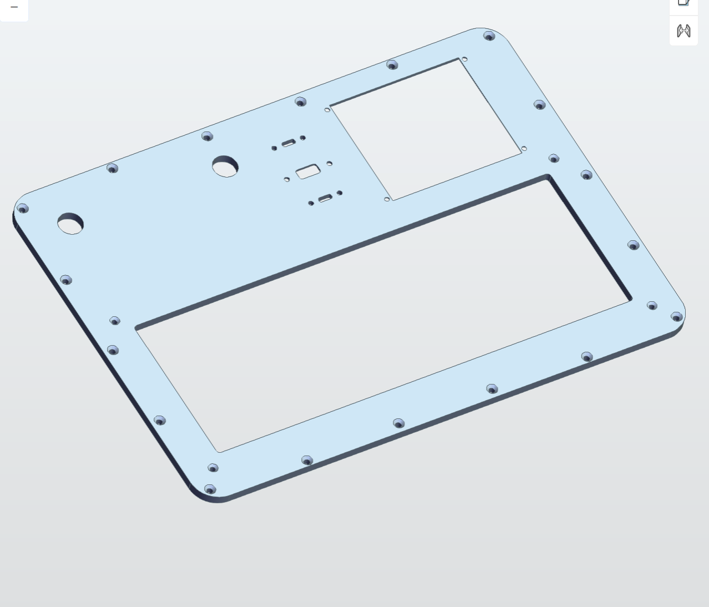
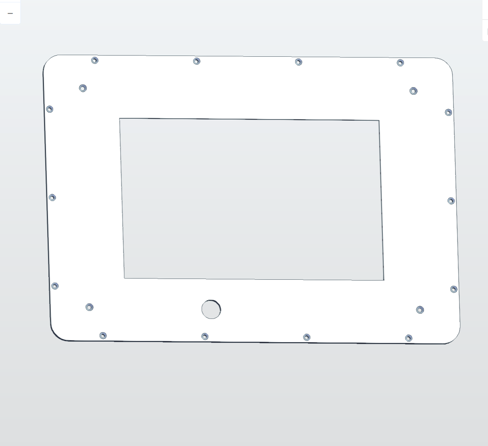
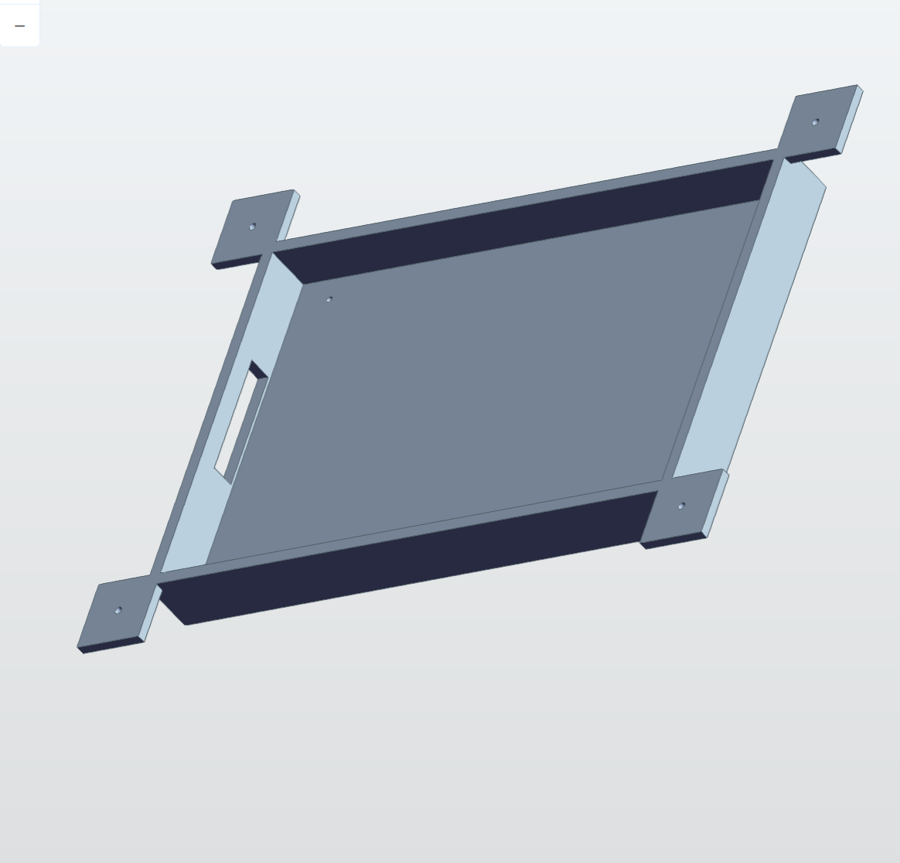

# Hi, I'm Yan

Computer Science student (3rd year) at Wentworth Institute of Technology, looking for a **Spring 2027 co-op** in software engineering. I'm big on **backend and databases**: APIs, data modeling, SQL, and making the server side solid. I'm also into developer tools.

### Ledjr: [ledjr.dev](https://ledjr.dev)
A personal finance app with real users: budgets, recurring bills on a calendar, debt payoff planning.\
Spring Boot, PostgreSQL, React + TypeScript, deployed on Heroku and Cloudflare.\
Session-based auth with CSRF protection, login rate limiting, 21 Flyway migrations, and scheduled jobs.\
Click **Try the demo** to look around without signing up. Code: [carascoy/Ledjr](https://github.com/carascoy/Ledjr)

### Currently building: version control for CAD
Git can save a 3D part, but its diff only says "binary files differ." I'm building a tool that reads inside the file to show what actually changed ("hole radius 7.69 → 7.12 mm") and what else that change affected. Built on top of git, starting with FreeCAD.

### What I work with
**Languages:** Java, Python, C, TypeScript, SQL, Bash\
**Frameworks:** Spring Boot, React\
**Tools:** PostgreSQL, Docker, Git, GitHub Actions, Linux

### Outside of code
I built a cyberdeck, a portable Linux computer: a Raspberry Pi 5 running Ubuntu Server, in a case held together with 3D-printed parts I designed. Keeping track of versions of those parts is what started my current project.

  
  
  

[LinkedIn](https://www.linkedin.com/in/yan-carasco/)
